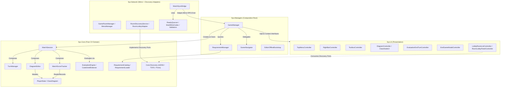

# SysBuilders — Architectural, SOLID & Clean Code Inspection

## 1. Executive Summary

The **SysBuilders** codebase demonstrates a **mature, well-layered architecture** that honours the core vision of [GameDesignDocument.md](file:///c:/Users/gabriel/sysbuilders/docs/GameDesignDocument.md) and [roadmap.md](file:///c:/Users/gabriel/sysbuilders/docs/roadmap.md), while having evolved significantly in its networking, discovery, and domain decomposition:

* **Clean Layering & Assembly Boundaries**: The four Unity assemblies ([Sys.Core.asmdef](file:///c:/Users/gabriel/sysbuilders/Assets/Scripts/Core/Sys.Core.asmdef), [Sys.UI.asmdef](file:///c:/Users/gabriel/sysbuilders/Assets/Scripts/UI/Sys.UI.asmdef), [Sys.Managers.asmdef](file:///c:/Users/gabriel/sysbuilders/Assets/Scripts/Managers/Sys.Managers.asmdef), [Sys.Network.asmdef](file:///c:/Users/gabriel/sysbuilders/Assets/Scripts/Network/Sys.Network.asmdef)) strictly respect the dependency direction `UI -> Core <- Managers <- Network`. `Sys.UI` and `Sys.Managers` have zero dependency on `Mirror` or `Sys.Network`.
* **No Monolithic God Classes**: Previous God-class tendencies in [`MatchSession`](file:///c:/Users/gabriel/sysbuilders/Assets/Scripts/Core/Session/MatchSession.cs), [`GameManager`](file:///c:/Users/gabriel/sysbuilders/Assets/Scripts/Managers/GameManager.cs), and [`MatchSyncBridge`](file:///c:/Users/gabriel/sysbuilders/Assets/Scripts/Network/MatchSyncBridge.cs) were substantially mitigated by extracting focused collaborators ([`DiagramEditor`](file:///c:/Users/gabriel/sysbuilders/Assets/Scripts/Core/Diagram/DiagramEditor.cs), [`MatchScoreTracker`](file:///c:/Users/gabriel/sysbuilders/Assets/Scripts/Core/Session/MatchScoreTracker.cs), [`SceneNavigator`](file:///c:/Users/gabriel/sysbuilders/Assets/Scripts/Managers/SceneNavigator.cs), [`EditorOfflineBootstrap`](file:///c:/Users/gabriel/sysbuilders/Assets/Scripts/Managers/EditorOfflineBootstrap.cs), [`ReadyQuorum`](file:///c:/Users/gabriel/sysbuilders/Assets/Scripts/Network/ReadyQuorum.cs), [`EvaluationPayloadValidator`](file:///c:/Users/gabriel/sysbuilders/Assets/Scripts/Network/EvaluationPayloadValidator.cs), [`SmellWireCodec`](file:///c:/Users/gabriel/sysbuilders/Assets/Scripts/Network/SmellWireCodec.cs), [`MatchStartCoordinator`](file:///c:/Users/gabriel/sysbuilders/Assets/Scripts/Network/MatchStartCoordinator.cs), and [`MatchAbortCoordinator`](file:///c:/Users/gabriel/sysbuilders/Assets/Scripts/Network/MatchAbortCoordinator.cs)).
* **Main Structural Issues to Address**:
  1. **Residual "Swiss-Army Facade" in [`MatchSession`](file:///c:/Users/gabriel/sysbuilders/Assets/Scripts/Core/Session/MatchSession.cs)**: Although [`DiagramEditor`](file:///c:/Users/gabriel/sysbuilders/Assets/Scripts/Core/Diagram/DiagramEditor.cs) and [`MatchScoreTracker`](file:///c:/Users/gabriel/sysbuilders/Assets/Scripts/Core/Session/MatchScoreTracker.cs) were extracted, `MatchSession` still implements all 6 interfaces and manually forwards ~95 lines of methods, properties, and events that `GameManager` already injects directly from the sub-objects.
  2. **Redundant UI Mediation & Duplicate Action Paths in [`GameManager`](file:///c:/Users/gabriel/sysbuilders/Assets/Scripts/Managers/GameManager.cs)**: `GameManager` acts as both Composition Root and an active UI mediator between [`ToolboxController`](file:///c:/Users/gabriel/sysbuilders/Assets/Scripts/UI/ToolboxController.cs) and [`DiagramController`](file:///c:/Users/gabriel/sysbuilders/Assets/Scripts/UI/DiagramController.cs), causing duplicate method-addition calls and redundant association-mode synchronization.
  3. **Domain Rules Leaking into [`ToolboxController`](file:///c:/Users/gabriel/sysbuilders/Assets/Scripts/UI/ToolboxController.cs)**: Class-per-turn limits (`_maxClassesPerTurn`) and pending-method checks (`HasPendingMethods`) live in the UI rather than `Sys.Core`, with a subtle method-identity bug when checking already-assigned methods by `Name` only.

---

## 2. Architecture & Class Interaction Analysis

### 2.1 Current Component & Dependency Graph



---

### 2.2 Evolution from `GameDesignDocument.md` & `roadmap.md`

| Area | Original Docs (`GDD` / `roadmap.md`) | Current Codebase Reality | Assessment |
| :--- | :--- | :--- | :--- |
| **Code Smells** | 3 smells: `LargeClass`, `DuplicateCode`, `LowCohesion` | 4 smells: Added `LowAffinityCoupling` in [`CodeSmellDetector`](file:///c:/Users/gabriel/sysbuilders/Assets/Scripts/Core/Evaluation/CodeSmellDetector.cs#L91-L129) | Positive evolution: gives Associations meaningful penalty rules when connecting unrelated classes. |
| **Refactor Points** | GDD mentions spending Refactor Points to unlock locked classes | Implemented via [`IRefactorPointPolicy`](file:///c:/Users/gabriel/sysbuilders/Assets/Scripts/Core/Session/RefactorPointPolicy.cs) (`DefaultRefactorPointPolicy` grants 2 initial points, 0 per turn) | Cleanly abstracted via Strategy pattern (`IRefactorPointPolicy`). |
| **Turn Timer** | GDD marks ~2 min timer as an open hypothesis; Roadmap puts timer in `ITurnContext` | Extracted into a dedicated [`ITurnTimerContext`](file:///c:/Users/gabriel/sysbuilders/Assets/Scripts/Core/Session/ITurnTimerContext.cs), optionally accepted by [`TopMenuController`](file:///c:/Users/gabriel/sysbuilders/Assets/Scripts/UI/TopMenuController.cs#L20) (unimplemented) | Better ISP than the original roadmap; avoids polluting [`ITurnContext`](file:///c:/Users/gabriel/sysbuilders/Assets/Scripts/Core/Session/ITurnContext.cs). |
| **LAN Discovery** | Roadmap specified Mirror's built-in `NetworkDiscovery` | Custom RFC 6762/6763 mDNS stack in `Core.Discovery.Mdns` + AES256-GCM TOFU verification in [`GameRoomManager`](file:///c:/Users/gabriel/sysbuilders/Assets/Scripts/Network/GameRoomManager.cs) | Massive architectural upgrade: pure C# protocol logic in Core, zero broadcast noise, and host identity pinning. |
| **Menu Management** | Roadmap specified a single `MenuManager` in `Managers` | Split between [`Network.MenuManager`](file:///c:/Users/gabriel/sysbuilders/Assets/Scripts/Network/MenuManager.cs) and a legacy [`Managers.MenuSceneManager`](file:///c:/Users/gabriel/sysbuilders/Assets/Scripts/Managers/MenuSceneManager.cs) | **Needs cleanup**: `MenuSceneManager` duplicates panel switching and loads `GameScene` into a dead offline state in builds. |

---

## 3. Cohesion, Conciseness & "God Class" Inspection

### 3.1 Is There a God Class?
No class in the project is an unmanageable God Class today, thanks to recent extractions. However, **two classes suffer from "Middleman / Mediator Bloat"** where responsibilities overlap:

#### 1. [`MatchSession`](file:///c:/Users/gabriel/sysbuilders/Assets/Scripts/Core/Session/MatchSession.cs) — The "Swiss-Army Facade" (266 lines)
* **What happened**: [`DiagramEditor`](file:///c:/Users/gabriel/sysbuilders/Assets/Scripts/Core/Diagram/DiagramEditor.cs) and [`MatchScoreTracker`](file:///c:/Users/gabriel/sysbuilders/Assets/Scripts/Core/Session/MatchScoreTracker.cs) were extracted from `MatchSession`, and `MatchSession` exposes them via properties (`DiagramActions => _editor`, `ScoreContext => _scoreTracker`, `TurnSummaryContext => _scoreTracker`, `MatchEndContext => _scoreTracker`).
* **The problem**: [`MatchSession`](file:///c:/Users/gabriel/sysbuilders/Assets/Scripts/Core/Session/MatchSession.cs#L10) **still declares that it implements `IScoreContext, ITurnSummaryContext, IMatchEndContext, IDiagramActions` itself**! As a result:
  * Lines 44–48 and 126–144 subscribe to `_editor` and `_scoreTracker` events just to re-fire identical events on `MatchSession`.
  * Lines 65–84 and 91–94 forward every score and selection property.
  * Lines 243–254 forward all 10 `IDiagramActions` methods to `_editor`.
* **Impact on Conciseness**: [`GameManager.InitializeUI`](file:///c:/Users/gabriel/sysbuilders/Assets/Scripts/Managers/GameManager.cs#L80-L122) already passes `Session.DiagramActions`, `Session.ScoreContext`, `Session.TurnSummaryContext`, and `Session.MatchEndContext` to the UI controllers. Removing those 4 redundant interface implementations from `MatchSession` eliminates **~95 lines of pure pass-through boilerplate** and makes `MatchSession` a concise session orchestrator.

#### 2. [`GameManager`](file:///c:/Users/gabriel/sysbuilders/Assets/Scripts/Managers/GameManager.cs) — Composition Root Mixing UI Mediation (274 lines)
According to [roadmap.md](file:///c:/Users/gabriel/sysbuilders/docs/roadmap.md#L56-L63), `GameManager` should act strictly as a **Composition Root**. However, in [`WireUI()`](file:///c:/Users/gabriel/sysbuilders/Assets/Scripts/Managers/GameManager.cs#L124-L145), it manually mediates between [`ToolboxController`](file:///c:/Users/gabriel/sysbuilders/Assets/Scripts/UI/ToolboxController.cs) and [`DiagramController`](file:///c:/Users/gabriel/sysbuilders/Assets/Scripts/UI/DiagramController.cs), duplicating communication that **already happens through [`DiagramEditor`](file:///c:/Users/gabriel/sysbuilders/Assets/Scripts/Core/Diagram/DiagramEditor.cs) (`IDiagramActions`)**:

> [!WARNING]
> **Duplicate Action Execution in Method Card Clicks & Association Mode**
> 1. **Method Card Click (`ToolboxController` + `GameManager`)**:
>    * When a player clicks a method card, [`ToolboxController.HandleCardClicked`](file:///c:/Users/gabriel/sysbuilders/Assets/Scripts/UI/ToolboxController.cs#L324-L332) calls `_diagramActions.AddMethodToClass(_diagramActions.SelectedClass, method)` **and** invokes `OnMethodCardSelected`.
>    * [`GameManager.HandleMethodCardSelected`](file:///c:/Users/gabriel/sysbuilders/Assets/Scripts/Managers/GameManager.cs#L190-L199) is subscribed to `OnMethodCardSelected` and attempts `_diagram.TryAddMethodToClass(selected.Node, method)` a second time (which only avoids adding twice or showing an error toast because of an explicit `if (selected.Node.Methods.Contains(method)) return;` guard in `GameManager`).
> 2. **Association Mode Sync (`ToolboxController` ↔ `GameManager` ↔ `DiagramController` ↔ `DiagramEditor`)**:
>    * Both `ToolboxController` and `DiagramController` already subscribe to `_diagramActions.OnAssociationModeChanged` and call `_diagramActions.SetAssociationMode(...)`.
>    * Yet `GameManager` **also** wires `_toolBox.OnAssociationModeToggled += _diagram.SetAssociationMode` and `_diagram.OnAssociationCreated += HandleAssociationCreated` (which calls `_toolBox.SetAssociationMode(false)`), even though [`DiagramEditor.AddRelation`](file:///c:/Users/gabriel/sysbuilders/Assets/Scripts/Core/Diagram/DiagramEditor.cs#L233) already calls `SetAssociationMode(false)`!

---

## 4. Domain Cohesion & Leaky Business Rules

### 4.1 Domain Rules Living in [`ToolboxController`](file:///c:/Users/gabriel/sysbuilders/Assets/Scripts/UI/ToolboxController.cs) (UI Layer)

Two core gameplay mechanics currently reside in [`ToolboxController`](file:///c:/Users/gabriel/sysbuilders/Assets/Scripts/UI/ToolboxController.cs) instead of `Sys.Core`:

1. **Class Creation Quota per Turn (`_maxClassesPerTurn = 2`)**:
   * [`PlayerState`](file:///c:/Users/gabriel/sysbuilders/Assets/Scripts/Core/Session/PlayerState.cs#L15) has a comment: `// TODO: Counter of classcreations this turns to limit how many allowed, generally 2 or 3 per turn.`
   * Instead, [`ToolboxController`](file:///c:/Users/gabriel/sysbuilders/Assets/Scripts/UI/ToolboxController.cs#L33-L40) tracks `_classesCreatedThisTurn`.
   * **Consequence**: The domain (`DiagramEditor` / `PlayerState`) does not enforce this rule, and if a player creates a class and deletes it in the same turn, `_classesCreatedThisTurn` is not decremented.

2. **Pending Methods Check & Method Identity Mismatch**:
   * [`ToolboxController.PopulateMethodsList`](file:///c:/Users/gabriel/sysbuilders/Assets/Scripts/UI/ToolboxController.cs#L250-L259) determines which methods from `CurrentRequirement` are still unplaced by building a `HashSet<string>` of method **names** across the diagram:
     ```csharp
     var assignedMethodNames = _diagram != null
         ? new HashSet<string>(_diagram.Classes.SelectMany(c => c.Methods).Select(m => m.Name), StringComparer.Ordinal)
         : new HashSet<string>(StringComparer.Ordinal);
     ```
   * **Bug / Design Risk**: In `Sys.Core` ([`RequirementChecker`](file:///c:/Users/gabriel/sysbuilders/Assets/Scripts/Core/Evaluation/RequirementChecker.cs#L35-L39) and [`CodeSmellDetector`](file:///c:/Users/gabriel/sysbuilders/Assets/Scripts/Core/Evaluation/CodeSmellDetector.cs#L67)), a method's identity is `(Name, Category)`—and a player can even place the same method in two classes (which triggers `DuplicateCode`). Furthermore, if a later turn introduces a method with the same `Name` but a different `Category` (or if the player hasn't placed all methods from `CurrentRequirement`), checking `assignedMethodNames.Contains(method.Name)` across the entire diagram can hide a required card from the toolbox!
   * Even more importantly, whether all required methods for the turn have been allocated (gating the "Finalizar Turno" button) is a **domain query** that belongs on `DiagramEditor` or `MatchSession`, not a UI predicate wired from `ToolboxController` to `RightBarController` via `GameManager`.

### 4.2 Incomplete Refactor Button State in [`RightBarController`](file:///c:/Users/gabriel/sysbuilders/Assets/Scripts/UI/RightBarController.cs)
* In [`RightBarController.UpdateRefactorDisplay`](file:///c:/Users/gabriel/sysbuilders/Assets/Scripts/UI/RightBarController.cs#L205-L208):
  ```csharp
  if (_refactorClassButton != null)
  {
      _refactorClassButton.interactable = currentPoints >= cost;
  }
  ```
* `IRefactorContext` provides `CanRefactorSelected()`, which checks `CanModifyDiagram()`, `SelectedClass != null`, `SelectedClass.IsLocked`, and `RefactorPoints >= RefactorCost`. However, `RightBarController` never checks `CanRefactorSelected()` and does not subscribe to selection changes, leaving the Refactor button clickable when no locked class is selected.

### 4.3 Dual Scoring Semantics (`MatchScoreTracker` vs `EvaluationResult`)
* [`EvaluationResult.TotalScore`](file:///c:/Users/gabriel/sysbuilders/Assets/Scripts/Core/Evaluation/EvaluationResult.cs#L23) clamps at zero: `Math.Max(0, rawScore - penaltyScore)`.
* [`MatchScoreTracker.CalculateScore`](file:///c:/Users/gabriel/sysbuilders/Assets/Scripts/Core/Session/MatchScoreTracker.cs#L75-L82) computes `lastRaw - sum(penalties)` without clamping (can go negative).
* [`EvaluationEndTurnController.UpdateDisplays`](file:///c:/Users/gabriel/sysbuilders/Assets/Scripts/UI/EvaluationEndTurnController.cs#L179) computes `pTotal = pEarned - pPenalty` (round delta minus round penalty, also unclamped).
* As noted in [server-authoritative-scoring.md](file:///c:/Users/gabriel/sysbuilders/docs/server-authoritative-scoring.md#L117-L125), `EvaluationResult.TotalScore` is currently misleading because `RawScore` is cumulative across turns while `PenaltyScore` is per-turn.

---

## 5. SOLID Principles Evaluation

| Principle | Grade | Strengths | Violations / Opportunities |
| :--- | :---: | :--- | :--- |
| **S — Single Responsibility** | **B** | Excellent decomposition in `Core.Evaluation` ([`RequirementChecker`](file:///c:/Users/gabriel/sysbuilders/Assets/Scripts/Core/Evaluation/RequirementChecker.cs), [`CodeSmellDetector`](file:///c:/Users/gabriel/sysbuilders/Assets/Scripts/Core/Evaluation/CodeSmellDetector.cs), [`SmellPenaltyCalculator`](file:///c:/Users/gabriel/sysbuilders/Assets/Scripts/Core/Evaluation/SmellPenaltyCalculator.cs)), `Core.Requirements`, and extracted `Network` helpers ([`ReadyQuorum`](file:///c:/Users/gabriel/sysbuilders/Assets/Scripts/Network/ReadyQuorum.cs), [`SmellWireCodec`](file:///c:/Users/gabriel/sysbuilders/Assets/Scripts/Network/SmellWireCodec.cs)). | • [`MatchSession`](file:///c:/Users/gabriel/sysbuilders/Assets/Scripts/Core/Session/MatchSession.cs) still acts as a pass-through facade for `_editor` and `_scoreTracker`.<br>• [`ToolboxController`](file:///c:/Users/gabriel/sysbuilders/Assets/Scripts/UI/ToolboxController.cs) mixes UI rendering, fallback prefab building (`CreateDefaultMethodCard`), class-creation quota rules, and pending-method domain logic.<br>• [`RoomDiscoveryService.cs`](file:///c:/Users/gabriel/sysbuilders/Assets/Scripts/Network/Discovery/RoomDiscoveryService.cs) bundles `DiscoveryChannel` and `RoomDiscoveryService` in a 553-line file. |
| **O — Open/Closed** | **B+** | [`IRefactorPointPolicy`](file:///c:/Users/gabriel/sysbuilders/Assets/Scripts/Core/Session/RefactorPointPolicy.cs) and [`IEvaluationService`](file:///c:/Users/gabriel/sysbuilders/Assets/Scripts/Core/Evaluation/IEvaluationService.cs) allow extending rules without modifying `MatchSession`. [`SmellPenaltyCalculator`](file:///c:/Users/gabriel/sysbuilders/Assets/Scripts/Core/Evaluation/SmellPenaltyCalculator.cs#L34-L40) fails loudly on unmapped smells. | Adding Phase 2 smells (e.g., `LazyClass`, `OverEngineering`) requires editing 4 classes: `CodeSmellType`, `CodeSmellDetector`, `SmellPenaltyCalculator`, and `EndGameModalController.TranslateSmell`. Introducing an `ICodeSmellRule` interface would make smell addition purely additive. |
| **L — Liskov Substitution** | **A** | Favoring composition over inheritance across all layers avoids fragile base classes. | Minor naming confusion in [`RequirementManager`](file:///c:/Users/gabriel/sysbuilders/Assets/Scripts/Managers/RequirementManager.cs#L49-L80): `public GetTrailById` returns `IReadOnlyList<Requirement>`, whereas explicit `IRequirementProvider.GetTrailById` returns `Trail`. |
| **I — Interface Segregation** | **A-** | Standout strength of the architecture: [`IRequirementContext`](file:///c:/Users/gabriel/sysbuilders/Assets/Scripts/Core/Session/IRequirementContext.cs), [`ITurnContext`](file:///c:/Users/gabriel/sysbuilders/Assets/Scripts/Core/Session/ITurnContext.cs), [`IScoreContext`](file:///c:/Users/gabriel/sysbuilders/Assets/Scripts/Core/Session/IScoreContext.cs), [`ITurnSummaryContext`](file:///c:/Users/gabriel/sysbuilders/Assets/Scripts/Core/Session/ITurnSummaryContext.cs), [`IMatchEndContext`](file:///c:/Users/gabriel/sysbuilders/Assets/Scripts/Core/Session/IMatchEndContext.cs), [`IRoomDirectory`](file:///c:/Users/gabriel/sysbuilders/Assets/Scripts/Core/Discovery/RoomDiscoveryPorts.cs), [`IRoomLobbySource`](file:///c:/Users/gabriel/sysbuilders/Assets/Scripts/Core/Discovery/RoomLobbyPorts.cs) are minimal and role-specific. | [`IDiagramActions`](file:///c:/Users/gabriel/sysbuilders/Assets/Scripts/Core/Diagram/IDiagramActions.cs) has 15 members mixing **domain mutation commands** (`TryCreateClass`, `AddMethodToClass`, `AddRelation`) with **UI selection/mode state** (`SelectedClass`, `IsAssociationMode`). |
| **D — Dependency Inversion** | **A-** | `Sys.UI` and `Sys.Managers` depend strictly on `Sys.Core` abstractions. Network discovery uses Ports & Adapters (`Core.Discovery` ports implemented by `Network.Discovery`). | • [`MatchSyncBridge`](file:///c:/Users/gabriel/sysbuilders/Assets/Scripts/Network/MatchSyncBridge.cs#L265) reaches through `gameManager.Session.TurnManager.ForceAdvancePhase()` (Law of Demeter violation).<br>• [`LobbyRoomListController`](file:///c:/Users/gabriel/sysbuilders/Assets/Scripts/UI/LobbyRoomListController.cs#L114-L123) and [`RoomLobbyPanelController`](file:///c:/Users/gabriel/sysbuilders/Assets/Scripts/UI/RoomLobbyPanelController.cs#L150-L159) duplicate a `FindPort<TPort>()` scene-wide service locator instead of receiving dependencies from a menu composition root. |

---

## 6. Clean Code & Hygiene Findings

1. **Compile-Time Enforcement of Pure C# Core (`Sys.Core.asmdef`)**:
   * [Sys.Core.asmdef](file:///c:/Users/gabriel/sysbuilders/Assets/Scripts/Core/Sys.Core.asmdef#L13) has `"noEngineReferences": false`. Setting `"noEngineReferences": true` will guarantee at compile time that no `UnityEngine` reference ever creeps into `Sys.Core`.
2. **Over-Referenced Assemblies in `Sys.Network.asmdef`**:
   * [Sys.Network.asmdef](file:///c:/Users/gabriel/sysbuilders/Assets/Scripts/Network/Sys.Network.asmdef#L10-L13) references `Mirror.Editor`, `Mirror.Examples`, `Mirror.Authenticators`, and `Unity.Mirror.CodeGen`. Referencing Editor/Example assemblies from a runtime assembly can break standalone player builds.
3. **Dead / Redundant [`MenuSceneManager`](file:///c:/Users/gabriel/sysbuilders/Assets/Scripts/Managers/MenuSceneManager.cs)**:
   * Overlaps with [`Network.MenuManager`](file:///c:/Users/gabriel/sysbuilders/Assets/Scripts/Network/MenuManager.cs) (`AbrirStart`, `AbrirTutorial`, `AbrirSettings`, `SelectedTheme`) and its `StartGame()` loads `GameScene` directly without starting a host or session.
4. **Unused / Redundant API Surface in [`RequirementManager`](file:///c:/Users/gabriel/sysbuilders/Assets/Scripts/Managers/RequirementManager.cs)**:
   * Properties `CurrentTheme`, `CurrentTrailId`, `CurrentRequirements`, and `SetActiveTrail` are stateful fields on the catalog manager that are never used by `GameManager` or `MatchSyncBridge`.
5. **UI Procedural Fallback Code Mixing with Controllers**:
   * [`ToolboxController.CreateDefaultMethodCard`](file:///c:/Users/gabriel/sysbuilders/Assets/Scripts/UI/ToolboxController.cs#L282-L322), [`LobbyRoomListController.CreateEntry`](file:///c:/Users/gabriel/sysbuilders/Assets/Scripts/UI/LobbyRoomListController.cs#L150-L205), and [`RoomLobbyPanelController.CreateRow`](file:///c:/Users/gabriel/sysbuilders/Assets/Scripts/UI/RoomLobbyPanelController.cs#L194-L226) construct complex Unity UI hierarchies in code when prefabs are null. Extracting small UI factory helpers (or relying on prefabs) would shrink controller line counts by ~25%.

---

## 7. Prioritized Refactoring Roadmap

If you want to act on this analysis, here is the highest-leverage order of improvements:

1. **Slim Down [`MatchSession`](file:///c:/Users/gabriel/sysbuilders/Assets/Scripts/Core/Session/MatchSession.cs) (Remove Middleman Boilerplate)**:
   * Stop implementing `IScoreContext`, `ITurnSummaryContext`, `IMatchEndContext`, and `IDiagramActions` directly on `MatchSession`; callers already use `Session.ScoreContext`, `Session.TurnSummaryContext`, `Session.MatchEndContext`, and `Session.DiagramActions`.
2. **Clean Up [`GameManager.WireUI()`](file:///c:/Users/gabriel/sysbuilders/Assets/Scripts/Managers/GameManager.cs#L124-L166) (Remove Duplicate Event Loops)**:
   * Remove `HandleMethodCardSelected` and the manual `OnAssociationModeToggled` / `OnAssociationCreated` cross-wiring in `GameManager`, letting `DiagramEditor` (`IDiagramActions`) be the single source of truth for both `ToolboxController` and `DiagramController`.
3. **Move Turn Class Quota & Pending Methods Check into `Sys.Core`**:
   * Move `_maxClassesPerTurn` and `_classesCreatedThisTurn` into `DiagramEditor` / `PlayerState` (and decrement when an unlocked class created this turn is removed).
   * Move `HasPendingMethods` into `MatchSession` / `DiagramEditor` using `(Name, Category)` identity rather than `Name` alone.
4. **Fix Refactor Button State in [`RightBarController`](file:///c:/Users/gabriel/sysbuilders/Assets/Scripts/UI/RightBarController.cs)**:
   * Bind `_refactorClassButton.interactable` to `_refactorContext.CanRefactorSelected()` and refresh when class selection or turn phase changes.
5. **Assembly & Dead-Code Cleanup**:
   * Set `"noEngineReferences": true` in [Sys.Core.asmdef](file:///c:/Users/gabriel/sysbuilders/Assets/Scripts/Core/Sys.Core.asmdef).
   * Prune `Mirror.Editor` and `Mirror.Examples` from [Sys.Network.asmdef](file:///c:/Users/gabriel/sysbuilders/Assets/Scripts/Network/Sys.Network.asmdef).
   * Consolidate or remove [`MenuSceneManager`](file:///c:/Users/gabriel/sysbuilders/Assets/Scripts/Managers/MenuSceneManager.cs) and unused state on [`RequirementManager`](file:///c:/Users/gabriel/sysbuilders/Assets/Scripts/Managers/RequirementManager.cs).
